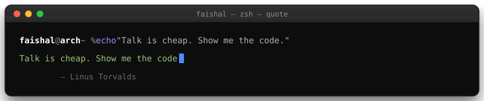
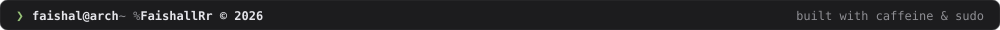

  

  

  
   
  click an icon · yes, they bounce on purpose

  
  
  

  

  

  

  

  
  
  
  
  
  

  

  

  

  

  

  

  

<table align="center" width="100%">
  <tr>
    <td align="center" width="55%">
      
    </td>
    <td align="center" width="45%">
      
       
      
    </td>
  </tr>
</table>

  

[ ft. BABYMETAL")](https://www.youtube.com/watch?v=fKyXvNkGQKc#gh-dark-mode-only)[ ft. BABYMETAL")](https://www.youtube.com/watch?v=fKyXvNkGQKc#gh-light-mode-only)
[![My Chemical Romance - I Don't Love You [Official Music Video] [HD]](https://ytcards.demolab.com/?id=pyi0ZfuIIvo&title=My%20Chemical%20Romance%20-%20I%20Don%27t%20Love%20You%20%5BOfficial%20Music%20Video%5D%20%5BHD%5D&lang=en&timestamp=1256544000&background_color=%230b0b0c&title_color=%23e5e5ea&stats_color=%238e8e93&max_title_lines=2&width=250&border_radius=10 "My Chemical Romance - I Don't Love You [Official Music Video] [HD]")](https://www.youtube.com/watch?v=pyi0ZfuIIvo#gh-dark-mode-only)[![My Chemical Romance - I Don't Love You [Official Music Video] [HD]](https://ytcards.demolab.com/?id=pyi0ZfuIIvo&title=My%20Chemical%20Romance%20-%20I%20Don%27t%20Love%20You%20%5BOfficial%20Music%20Video%5D%20%5BHD%5D&lang=en&timestamp=1256544000&background_color=%230b0b0c&title_color=%23e5e5ea&stats_color=%238e8e93&max_title_lines=2&width=250&border_radius=10 "My Chemical Romance - I Don't Love You [Official Music Video] [HD]")](https://www.youtube.com/watch?v=pyi0ZfuIIvo#gh-light-mode-only)

<a href="https://www.youtube.com/@faishalrr">youtube.com/@faishalrr</a> · currently on repeat

  

  

