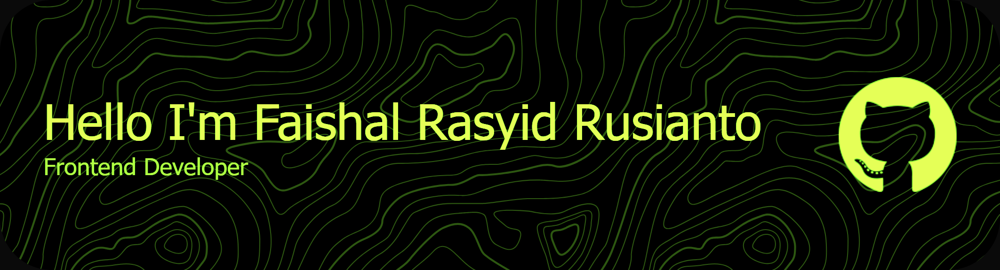
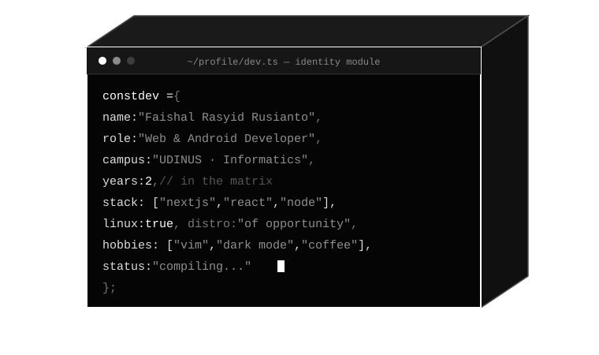

<p align="center">
  
</p>

<p align="center">
  
</p>

<p align="center">
  
  
  
</p>

<p align="center">
  
</p>

<p align="center">
  
</p>

---

## ▚ 01 :: IDENTITY_DEV.TS

<p align="center">
  
</p>

---

## ▚ 02 :: NEOFETCH_OUT

<p align="center">
  
</p>

---

## ▚ 03 :: SKILL_INDEX

<p align="center">
  
</p>

---

## ▚ 04 :: SNAKE_PROCESS

<p align="center">
  
</p>

---

## ▚ 05 :: FAQ_CHAT.LOG

<p align="center">
  
</p>

---

## ▚ 06 :: ERROR_LOG

<p align="center">
  
</p>

---

## ▚ 07 :: TELEMETRY

<table align="center" width="100%">
  <tr>
    <td align="center" width="55%">
      
    </td>
    <td align="center" width="45%">
      
      <br/>
      
    </td>
  </tr>
</table>

<p align="center">
  
</p>

---

## ▚ 08 :: NOW_PLAYING

<p align="center">
  <a href="https://open.spotify.com/user/31kvgece4tbb6pxa5f6ag4y42xly">
    
  </a>
</p>

---

## ▚ 09 :: TOOLCHAIN

<table align="center">
  <tr>
    <td></td>
    <td></td>
    <td></td>
    <td></td>
    <td></td>
    <td></td>
  </tr>
</table>

---

## ▚ 10 :: UPLINK_CHANNELS

<div align="center">
  <a href="https://www.instagram.com/_faishallrr">
    
  </a>
  <a href="https://www.linkedin.com/in/faishal-rasyid-rusianto-6a5544322/">
    
  </a>
  <a href="https://discord.com/users/faishalrr">
    
  </a>
  <a href="https://www.youtube.com/@faishalrr">
    
  </a>
  <a href="https://www.tiktok.com/@faishallrr_?is_from_webapp=1&sender_device=pc">
    
  </a>
</div>

---

```
$ echo "Talk is cheap. Show me the code."
Talk is cheap. Show me the code.
        — Linus Torvalds
```

<p align="center">
  <sub>▓ mono//mainframe build — <b>FaishallRr © 2026</b> — no colors detected ▓</sub>
</p>
