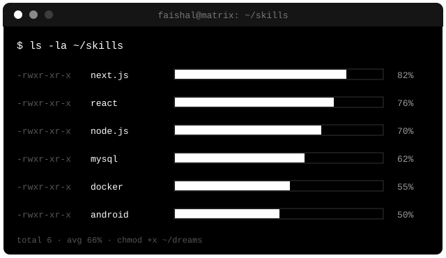

<p align="center">
  
</p>

<p align="center">
  
</p>

<p align="center">
  
  
  
  
</p>

<p align="center"></p>

<h3 align="center"><code>$ neofetch</code></h3>

<p align="center">
  
</p>

<h3 align="center"><code>$ ls -la ~/skills</code></h3>

<p align="center">
  
</p>

<p align="center">
  
  
  
  
  
  
</p>

<p align="center"></p>

<h3 align="center"><code>$ sudo rm -rf bugs/</code></h3>

<p align="center">
  
</p>

<h3 align="center"><code>$ git log --graph</code></h3>

<p align="center">
  
</p>

<h3 align="center"><code>$ htop</code></h3>

<table align="center" width="100%">
  <tr>
    <td align="center" width="55%">
      
    </td>
    <td align="center" width="45%">
      
      <br/>
      
    </td>
  </tr>
</table>

<h3 align="center"><code>$ now-playing</code></h3>

<p align="center">
  <a href="https://open.spotify.com/user/31kvgece4tbb6pxa5f6ag4y42xly">
    
  </a>
</p>

<p align="center"></p>

<h3 align="center"><code>$ ping faishal</code></h3>

<div align="center">
  <a href="https://www.instagram.com/_faishallrr"></a>
  <a href="https://www.linkedin.com/in/faishal-rasyid-rusianto-6a5544322/"></a>
  <a href="https://discord.com/users/faishalrr"></a>
  <a href="https://www.youtube.com/@faishalrr"></a>
  <a href="https://www.tiktok.com/@faishallrr_"></a>
</div>

<br/>

```
$ echo "Talk is cheap. Show me the code."
Talk is cheap. Show me the code.
        — Linus Torvalds
```

<p align="center"><sub>faishal@arch ~ <b>FaishallRr © 2026</b> ~ built with caffeine &amp; sudo</sub></p>
